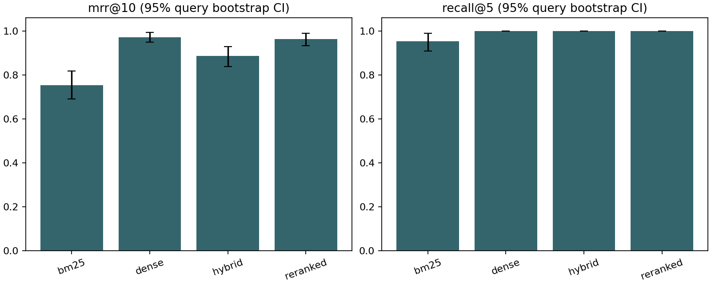
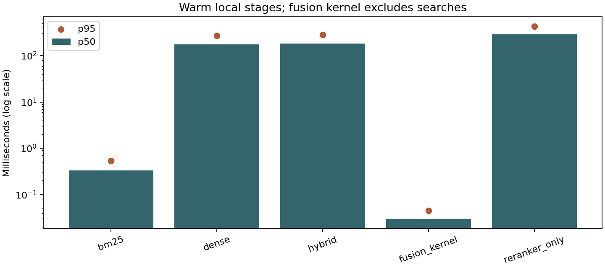

# Offline evaluation results

Generated from saved predictions and frozen synthetic qrels. These are retrieval results, not answer correctness.

Documents: 25; queries: 100; retrieval-labeled: 87.

| Configuration | Recall@1 | Recall@5 | MRR@10 | nDCG@10 |
|---|---:|---:|---:|---:|
| bm25 | 0.4377 [0.3544, 0.5211] | 0.9531 [0.9080, 0.9885] | 0.7541 [0.6897, 0.8172] | 0.8034 [0.7560, 0.8473] |
| dense | 0.7577 [0.6915, 0.8257] | 1.0000 [1.0000, 1.0000] | 0.9713 [0.9483, 0.9943] | 0.9767 [0.9589, 0.9930] |
| hybrid | 0.6140 [0.5259, 0.6935] | 1.0000 [1.0000, 1.0000] | 0.8860 [0.8381, 0.9282] | 0.9110 [0.8753, 0.9420] |
| reranked | 0.7462 [0.6782, 0.8113] | 1.0000 [1.0000, 1.0000] | 0.9636 [0.9330, 0.9885] | 0.9665 [0.9434, 0.9851] |

Brackets: 95% query-bootstrap percentile intervals (2000 resamples, seed 20261020).
Repeated runs are reported separately; repeated queries are not pooled as independent evidence.

## Paired differences

| Treatment minus baseline | Metric | Mean delta | 95% CI |
|---|---|---:|---|
| bm25_minus_dense | recall@1 | -0.3199 | [-0.4292, -0.2184] |
| bm25_minus_dense | recall@5 | -0.0469 | [-0.0949, -0.0115] |
| bm25_minus_dense | mrr@10 | -0.2171 | [-0.2859, -0.1520] |
| bm25_minus_dense | ndcg@10 | -0.1733 | [-0.2241, -0.1272] |
| hybrid_minus_dense | recall@1 | -0.1437 | [-0.2356, -0.0631] |
| hybrid_minus_dense | recall@5 | +0.0000 | [+0.0000, +0.0000] |
| hybrid_minus_dense | mrr@10 | -0.0852 | [-0.1360, -0.0393] |
| hybrid_minus_dense | ndcg@10 | -0.0658 | [-0.1025, -0.0319] |
| reranked_minus_hybrid | recall@1 | +0.1322 | [+0.0402, +0.2299] |
| reranked_minus_hybrid | recall@5 | +0.0000 | [+0.0000, +0.0000] |
| reranked_minus_hybrid | mrr@10 | +0.0776 | [+0.0268, +0.1312] |
| reranked_minus_hybrid | ndcg@10 | +0.0556 | [+0.0176, +0.0959] |

Intervals include query sampling uncertainty only; synthetic authoring bias and corpus mismatch are not captured.

## Warm local performance

| Stage | Samples | p50 ms | p95 ms |
|---|---:|---:|---:|
| bm25 | 300 | 0.330 | 0.541 |
| dense | 300 | 176.793 | 272.729 |
| hybrid | 300 | 181.157 | 283.712 |
| fusion_kernel | 300 | 0.030 | 0.045 |
| reranker_only | 300 | 289.826 | 429.680 |

Local hybrid concurrency: 12 requests, 2 workers; failures 0/12 (0.0%); p50 230.491 ms, p95 368.915 ms.
This is a small thread-pool retrieval test; it excludes HTTP, Gemini and event-loop contention.

## Experiment status

| Stage | Status | Attempts | Failures | Reason |
|---|---|---:|---:|---|
| dense | complete | 300 | 0 |  |
| hybrid | complete | 300 | 0 |  |
| reranked | complete | 300 | 0 |  |
| graph | incomplete | 0 | 0 | not requested; use the optional dedicated runner |
| generation | incomplete | 0 | 0 | not requested; use the optional dedicated runner |
| http_end_to_end | incomplete | 0 | 0 | not requested; use the optional dedicated runner |
| bm25 | complete | 300 | 0 |  |

See [methods and limitations](README.md), [repository audit](audit.md), and [human review](human-review.md).

